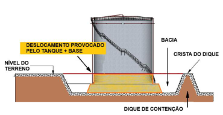
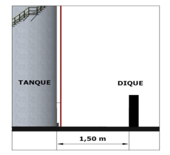

<!-- convertido de IT25P2.pdf pelo converter.py (SSEG) -->

<!-- pág 1 -->

Atualizada pela Portaria nº CCB 003/800/25 publicada no Diário Oficial do Estado, de 20 de março de 2025

SECRETARIA DA SEGURANÇA PÚBLICA

POLÍCIA MILITAR DO ESTADO DE SÃO PAULO

Corpo de Bombeiros

INSTRUÇÃO TÉCNICA Nº 25/2025

Líquidos igníferos (inflamáveis e combustíveis)

Parte 2 – Armazenamento em tanques estacionários

SUMÁRIO

16 Aplicação

17 Requisitos para os tanques de armazenamento

18 Tanques de armazenamento de superfície

19 Tanques subterrâneos

20 Edificações contendo tanques de armazenamento

21 Isolamento de tanques

22 Demais requisitos

<!-- pág 2 -->

16 APLICAÇÃO

**16.1** A Parte 2 desta IT especifica os requisitos exigíveis para:

armazenamento de líquidos igníferos (inflamáveis e combustíveis), em tanques fixos que excedam a capacidade individual de 250 l;

armazenamento de líquidos igníferos (inflamáveis e combustíveis) em tanques portáteis, cujas capacidades sejam superiores a 2.500 l;

armazenamento de líquidos igníferos (inflamáveis e combustíveis) em recipientes intermediários para granel (IBC), cujas capacidades sejam superiores a 3.000 l;

o projeto, a instalação, os ensaios, a operação e a manutenção dos tanques de superfície, subterrâneos, instalados no interior de edificações, portáteis e dos recipientes para granéis.

**16.2** Esta IT não se aplica aos casos mencionados no item 2.2. da Parte 1.

17 Requisitos para os tanques de armazenamento

**17.1** Geral

**17.1.1** O armazenamento de líquidos de classe II e de classe III aquecidos nas temperaturas iguais ou superiores aos seus pontos de fulgor deve seguir os requisitos para líquidos de classe I, a menos que uma avaliação de engenharia conduzida de acordo com o gerenciamento de riscos justifique o atendimento aos requisitos para alguma outra classe de líquido.

**17.1.2** Os tanques projetados para serem utilizados como tanques de superfície não podem ser usados como tanques subterrâneos e vice-versa.

**17.1.3** Não é permitida a instalação de tanques contendo líquidos igníferos (inflamáveis e combustíveis) em subsolos, exceto nos casos em que o tanque armazene líquidos de classe II ou III com a finalidade de abastecer grupos motogeradores e o volume total seja limitado a 500 litros, para cada área compartimentada.

a. para os casos acima, quando a alimentação do grupo motogerador for por meio de tanques instalados em área externa, deve ser prevista válvula de bloqueio.

b. nos casos em que o tanque que armazena líquidos de classe II ou III com a finalidade de abastecer grupos moto geradores for instalado em pavimentos superiores ao pavimento térreo o limite de armazenamento deve ser 250 L para cada área compartimentada.

**17.1.4** Os tanques devem ser projetados e construídos de acordo com Normas Brasileiras ou, na inexistência destas, de acordo com outras normas internacionalmente aceitas para o material de construção que esteja sendo utilizado.

**17.2** Projeto e construção de tanques de armazenamento

**17.2.1** Materiais de construção

Os tanques devem ser adequados, de aço ou outros materiais não combustíveis, devendo estar de acordo com os requisitos aplicáveis mencionados nas letras “a” a “f”.

Os materiais utilizados na construção dos tanques e seus acessórios devem ser compatíveis com o produto a ser armazenado. Em caso de dúvida sobre as propriedades do líquido a ser armazenado, deve ser consultado o fabricante do produto.

Os tanques construídos em materiais combustíveis podem ser aplicados, limitados a:

instalações subterrâneas;

uso onde as propriedades do líquido armazenado assim o exigirem;

armazenamento de superfície de líquidos de classe IIIB em áreas não expostas ao derramamento ou vazamento de líquidos de classe I ou de classe II;

armazenamento de líquidos de classe IIIB dentro de uma edificação protegida por sistema de chuveiros automáticos aprovado pelo CBPMESP.

Os tanques de concreto, sem revestimento, podem ser utilizados para o armazenamento de líquidos com densidade igual ou superior a 40º API. Tanques de concreto com revestimento especial podem ser utilizados com outros líquidos, desde que sejam projetados e construídos de acordo com normas técnicas nacionais ou, na inexistência destas, de acordo com outras normas internacionalmente aceitas.

Os tanques podem ter revestimentos combustíveis ou não combustíveis. A seleção, a especificação e o tipo do material de revestimento e sua espessura requerida devem ser baseados nas propriedades do líquido a ser armazenado.

Quando houver mudança nas características do líquido a ser armazenado, a compatibilidade do revestimento e do líquido deve ser verificada.

Devem ser adotados critérios adequados de projeto quando a densidade do líquido armazenado exceder a da água ou se o tanque for projetado para conter líquidos a uma temperatura abaixo de -18 ºC.

**17.3** Prevenção e controle de incêndio

**17.3.1** As instalações de armazenamento devem estabelecer e implementar métodos de prevenção e controle de incêndio para garantir a segurança das pessoas, para minimizar as perdas de patrimônio e para reduzir a exposição ao fogo das propriedades adjacentes resultantes de incêndio e explosão.

**17.3.2** De modo a prevenir a ignição de vapores inflamáveis em instalações com tanques de armazenamento, as fontes de ignição devem ser controladas.

**17.4** Gerenciamento de riscos de incêndio

a. Além do previsto na IT 16, o gerenciamento de risco em parques de tanques deve ser observado, no mínimo, o previsto nas letras “b” e “c”.

b. A extensão dos procedimentos para prevenção e controle de incêndios e explosões e as medidas previstas para instalações de armazenamento com tanques deve ser determinada por meio de avaliação de engenharia das instalações e das operações, seguida pela aplicação de princípios de engenharia de processo reconhecidos para proteção contra incêndios e explosões. A avaliação deve incluir, e não se limitar, ao seguinte:

1) análise dos riscos para incêndio e explosão das <!-- pág 3 --> instalações;

2) análise das condições locais como exposição para as propriedades adjacentes, potencial para inundações ou potencial para terremotos;

3) limites da propriedade, potencial de inundação ou potencial de abalos sísmicos;

4) tempo de resposta do CBPMESP ou do plano de auxílio mútuo;

5) análise do acesso das equipes de combate a incêndio ao parque de tanques, tais como existência de edificações próximas que limitem o combate ao incêndio, vias de acesso e posicionamento de viaturas, distribuição dos equipamentos de proteção.

c. O Plano de Ação de Emergência (PAE), consistente com os equipamentos, pessoal e recursos disponíveis deve ser estabelecido e implementado para atender a incêndios, explosões e outras emergências. Este plano deve incluir:

1) procedimentos a serem utilizados em caso de incêndios, explosões ou vazamentos acidentais de líquidos ou vapores, incluindo, mas não se limitando ao acionamento de alarme sonoro e/ou visual, acionamento do CBPMESP, do Organismos de Cooperação Mútua (OCM), evacuação do pessoal e controle, mitigação, combate e extinção de incêndios e explosões;

2) planejamento e treinamento do pessoal para executar as atividades de resposta a emergências;

3) manutenção dos equipamentos de proteção contra incêndios, de contenção de vazamentos e derrames e outros equipamentos de resposta à emergências;

4) planejamento dos exercícios de combate a emergências;

5) desligamento ou isolamento de equipamentos para controlar vazamentos eventuais, visando à redução ou eliminação de vazamentos eventuais de líquidos;

6) adoção de medidas alternativas para garantir a segurança do pessoal enquanto qualquer equipamento de proteção contra fogo estiver desligado ou inoperante.

d. O planejamento de medidas efetivas para o controle de incêndios deve ser coordenado por meios locais de avaliação de emergências. Isto deve incluir, mas não se limitar à identificação de todos os tanques pelas suas localizações, pelos seus conteúdos, pelas suas dimensões (capacidades) e pela identificação adequada do risco, como requerido nesta IT.

e. Os procedimentos de emergência devem permanecer disponíveis nas áreas operacionais. Os procedimentos devem ser revisados e atualizados sempre que as condições forem alteradas.

f. Onde existir a possibilidade de locais ficarem sem atendimento durante considerável período, um resumo do Plano de Emergência deve ser colocado à disposição e localizado em pontos estratégicos, facilmente acessíveis aos membros da Brigada.

**17.4.1** Inspeção e manutenção dos equipamentos de proteção contra incêndio

Todos os equipamentos de proteção contra incêndio devem ser submetidos à manutenção correta e passar por ensaios periódicos de acordo com a legislação, práticas padrão e recomendações dos fabricantes.

As práticas e procedimentos de manutenção e operação de instalações de armazenamento devem ser estabelecidos e implementados para controlar e prevenir vazamento e derrame de líquidos.

As áreas ao redor das instalações de tanques de armazenamento devem ser conservadas e livres de ervas daninhas, lixo e outros materiais combustíveis desnecessários.

Passarelas destinadas à movimentação do pessoal devem ser mantidas livres de obstruções, a fim de permitir a evacuação ordenada e o pronto acesso para o combate manual de incêndios e de resposta a emergências, de acordo com a legislação e o plano de emergência.

Os resíduos de materiais combustíveis e os resíduos nas áreas de operação devem ser limitados ao mínimo, e devem ser depositados diariamente em recipientes adequados, dotados de tampas, sendo descartados periodicamente.

**17.5** Operações de tanques de armazenamento

**17.5.1** Identificação e segurança patrimonial

Uma sinalização ou marcação que atenda à Norma

Brasileira aplicável ou outra internacionalmente aceita deve ser aplicada aos tanques de armazenamento que contenham líquidos igníferos (inflamáveis e combustíveis). A sinalização não precisa ser aplicada diretamente ao tanque, mas deve situar-se em local onde possa ser prontamente visualizada, como na lateral de uma via de acesso, em passarelas para os tanques, ou na tubulação fora da bacia de contenção. Havendo mais de um tanque na bacia de contenção, a sinalização deve localizar-se de tal modo que cada tanque possa ser prontamente identificado.

Tanques de armazenamento de superfícies, isolados ou em áreas não supervisionadas também devem ser protegidos e marcados para identificar o risco de incêndio do tanque e o seu conteúdo para o público em geral.

Tanques de armazenamento devem ser protegidos e sinalizados de forma a identificar no mínimo o conteúdo, os riscos do produto (inflamabilidade, toxicidade, corrosividade e/ou riscos específicos) e informações para proteção das instalações (por exemplo: “não fumar”, “não portar dispositivo gerador de ignição” “não portar aparelho celular” etc.). A área de localização dos tanques deve ser protegida contra violação ou invasão.

**17.5.2** Remoção, desativação, reutilização e reativação de serviço de tanques de armazenamento

Tanques de superfície colocados fora de serviço ou abandonados requerem total esgotamento de líquidos e total remoção de vapores; devem ainda ser protegidos contra violações, estarem desconectados e sinalizados.

Tanques de superfície podem ser reutilizados ou reativados no armazenamento de líquidos igníferos (inflamáveis e combustíveis), sendo que, caso haja alterações dos cenários existentes pela substituição do produto, com agravamento de risco do pior cenário, as proteções devem ser revistas conforme a presente IT.

18 Tanques de armazenamento de superfície

<!-- pág 4 -->

**18.1** Requisitos gerais

O armazenamento de líquidos de classe II e de classe III aquecidos a temperaturas iguais ou acima de seus pontos de fulgor deve seguir os requisitos para líquidos de classe I.

**18.2** Localização de tanques de armazenamento de superfície

**18.2.1** Localização em relação aos limites de propriedade, vias de circulação interna e edificações

Todos os tanques destinados ao armazenamento de líquidos estáveis de classe I, classe II ou classe IIIA e operando com pressões manométricas que não excedam 17 kPa, devem ser localizados de acordo com as Tabelas 2.1 e 2.2. Onde o espaçamento do tanque for baseado em um projeto que adote a solda fragilizada entre o teto e o costado, o responsável técnico deve apresentar comprovação de responsabilidade técnica que trate da adoção deste método construtivo.

Os tanques verticais que disponham de solda fragilizada entre o teto e o costado e que armazenem líquidos de classe IIIA podem ser localizados na metade das distâncias especificadas na Tabela 2.1, desde que não estejam dentro de uma bacia de contenção com tanques que armazenem líquidos de classe I e classe II ou não estejam no curso do canal de drenagem para a bacia de contenção à distância de tanques que armazenem líquidos de classe I ou classe II.

Todos os tanques destinados ao armazenamento de líquidos estáveis de classe I, classe II ou classe IIIA e operando com pressões manométricas superiores a 17 kPa, ou que sejam equipados com dispositivos de ventilação de emergência que operem com pressões manométricas superiores a 17 kPa, devem ser localizados de acordo com as Tabelas 2.2 e 2.3.

Todos os tanques destinados ao armazenamento de líquidos com características de ebulição turbilhonar devem ser localizados de acordo com a Tabela 2.4. Os líquidos com características de ebulição turbilhonar não podem ser armazenados em tanques de teto fixo, com diâmetro superior a 45 m, exceto quando um sistema de inertização adequado e aprovado for instalado no tanque.

Todos os tanques destinados ao armazenamento de líquidos instáveis devem ser localizados de acordo com as Tabelas 2.2 e 2.5.

Todos os tanques destinados ao armazenamento de líquidos estáveis de classe IIIB devem ser localizados de acordo com a Tabela 2.6, exceto quando localizados na mesma bacia de contenção ou no curso do canal de drenagem para a bacia de contenção à distância de tanques que armazenem líquidos de classe I ou classe II, neste caso, devem ser localizados conforme determinado neste item e nas Tabelas 2.1 e 2.2.

No caso de a propriedade adjacente ser uma instalação similar, os parâmetros de distâncias podem, com o consentimento por escrito dos dois proprietários, adotar metade das distâncias mínimas especificadas na Tabela 2.1.

Quando o rompimento das extremidades de um vaso de pressão ou tanque horizontal pressurizado expuser a risco as propriedades adjacentes e/ou edificações internas, este vaso de pressão ou tanque horizontal pressurizado deve ter seu eixo longitudinal paralelo a estas propriedades e/ou instalações mais próximas e mais importantes.

**18.2.2** Distância (entre costados) entre dois tanques de superfície adjacentes

Os tanques de armazenamento de líquidos estáveis de classe I, classe II ou classe IIIA devem ter um espaçamento de acordo com a Tabela 2.7, somando sempre cada tanque e o seu adjacente, isto é, dois a dois.

Onde houver o envolvimento de mais de dois tanques, a soma dos diâmetros deve ser calculada para cada par de tanques possível. Por exemplo, quatro tanques no interior de uma bacia de contenção, numerados de 1 a 4, posicionados no sentido dos ponteiros do relógio, a partir do tanque 1, os diâmetros de cada par de tanques, deverão ser somados, conforme a seguir: 1 e 2, 1 e 3, 1 e 4, 2 e 3, 2 e 4 e 3 e 4.

Em instalações de produção, situadas em regiões isoladas, nos tanques de petróleo cru com capacidades individuais de no máximo 480.000 l, o espaçamento deve ser no mínimo 1,0 m, não requerendo a aplicação da

Tabela 2.7.

A distância entre os tanques de armazenamento de líquidos de classe IIIB deve ser de, no mínimo, 1,0 m, desde que eles não estejam localizados na mesma bacia de contenção que armazene líquidos de classe I ou classe II ou próximos ao curso do seu canal de drenagem para uma bacia de contenção à distância de tanques.

Caso contrário, devem ser aplicadas as distâncias recomendadas na Tabela 2.7 para líquidos de classe IIIA.

A distância entre um tanque que armazene líquido instável ou sujeito a ebulição turbilhonar e outros tanques que armazenem líquidos estáveis ou líquidos de classe I, II ou III não pode ser inferior à metade da soma de seus diâmetros.

Quando tanques forem localizados em bacias de contenção, armazenando líquidos de classe I, II ou IIIA, ou próximo ao curso do canal de drenagem para a bacia de contenção à distância de tanques que armazenem líquidos de classe I, II ou IIIA, e estejam agrupados em três ou mais fileiras, ou quando se encontrarem em uma disposição irregular, devem ser previstos meios para fazer com que os tanques com esta disposição possam ficar acessíveis por uma proteção de resfriamento por canhão ou linha manual para situações de combate a incêndios, independente da proteção por aspersores, conforme requerido e aprovado pelo CBPMESP. Para atendimento deste item não é permitida a instalação de canhões no interior da bacia ou o acesso com linhas manuais à bacia do tanque considerado em chamas.

A distância mínima entre um vaso ou recipiente de gás liquefeito de petróleo (GLP) e um tanque de armazenamento de líquidos de classe I, classe II ou classe IIIA deve ser de 6 m.

Devem ser previstos diques, canais de drenagem para a bacia de contenção à distância e desníveis, de modo a não ser possível o acúmulo de líquidos de classe I, classe II ou classe IIIA sob um vaso contendo GLP, adjacente à tancagem.

Onde tanques de armazenamento de líquidos igníferos (inflamáveis e combustíveis) estiverem em uma bacia de contenção, os vasos de armazenamento de GLP devem <!-- pág 5 --> ficar fora da bacia e no mínimo a uma distância de 1 m da linha de centro da face externa da parede do dique.

Se os tanques de armazenamento de líquidos de classe

I, classe II ou classe IIIA estiverem operando com pressões manométricas que excedam 17 kPa, ou equipados com dispositivos de ventilação de emergência que trabalhem a pressões superiores a 17 kPa, devem ser separados dos vasos contendo GLP conforme distâncias determinadas na Tabela 2.7.

As disposições contidas nas letras “g”, “h” e “i” deste item não se aplicam onde forem instalados recipientes contendo GLP com capacidade máxima de 475 l, próximos a tanques de suprimento de óleo combustível com capacidade igual ou inferior a 2.500 l.

**18.3** Alívio de emergência em tanques de armazenamento de superfície quando expostos ao fogo

Todo tanque de armazenamento de superfície deve ter uma forma construtiva ou possuir um ou mais dispositivos de emergência que promovam o alívio da pressão interna excessiva, causada pela exposição ao fogo.

Este requisito também se aplica a cada um dos compartimentos de um tanque compartimentado e ao espaço intersticial (anular) de um tanque com contenção secundária.

Os espaços confinados, como os limitados pelo isolamento, por membranas ou por proteção contra intempéries, que possam reter líquidos decorrentes de vazamento do vaso primário e impedir a ventilação durante uma exposição ao fogo, também devem atender às prescrições de alívio de emergência mencionadas em

**18.3** O isolamento, a membrana e a proteção contra as intempéries não podem interferir na ventilação de emergência adequada.

Os tanques com capacidade acima de 45 m³ que armazenem líquidos de classe IIIB e que estejam localizados fora da bacia de contenção ou do canal da drenagem de líquidos de classe I ou de classe II não requerem alívio de emergência.

O sistema de alívio de emergência referido em 18.3. pode ser suprido pela adoção da forma construtiva de tanques verticais, como teto flutuante, solda fragilizada entre o teto e o costado ou outro tipo de dispositivo aprovado, que promova o alívio de pressão.

Se forem armazenados líquidos instáveis, devem ser levados em consideração os efeitos do calor ou dos gases resultantes da polimerização, decomposição, condensação ou autorreatividade.

Se for previsível (ou previsto) um escoamento bifásico (líquido + gás) durante um alívio de emergência, é necessária uma avaliação de engenharia, a fim de dimensionar os dispositivos de alívio de pressão.

**18.4** Proteção contra incêndio para tanques de armazenamento de superfície

Deve ser previsto um sistema de combate a incêndio de acordo com a parte 3 desta IT.

**18.5** Requisitos adicionais para tanques de armazenamento de superfície resistentes ao fogo

Tanques resistentes ao fogo devem ser projetados e ensaiados de acordo com Norma Brasileira aplicável e, na inexistência desta, de acordo com a UL 2080 ou norma internacionalmente aceita.

**18.6** Requisitos adicionais para tanques de armazenamento de superfície protegidos

Tanques de superfície protegidos devem ser projetados e ensaiados de acordo com Norma Brasileira aplicável e, na inexistência desta, de acordo com a UL 2085 ou norma internacionalmente aceita.

**18.7** Controle de derramamentos de tanques de armazenamento de superfície

**18.7.1** Todos os tanques que armazenem líquidos de classe I, classe II ou classe III devem ser dotados de meios que impeçam que a ocorrência acidental de derramamento de líquidos e venha a colocar em risco instalações importantes ou propriedades adjacentes, ou alcancem cursos d’água. Tais meios devem atender, quando aplicáveis, a um ou mais dos requisitos contidos em 18.7.4, a 18.7.6. o controle de vazamentos deve levar em conta, além do volume do tanque a ser protegido, a 50% do volume da água utilizada para o combate a incêndio dos sistemas de espuma e resfriamento.

**18.7.2** Recomenda-se que o controle de vazamentos leve em conta, além do volume do tanque a ser protegido, o volume de 50% do total da água utilizada para o combate a incêndio dos sistemas de espuma e resfriamento.

**18.7.3** Quando for apresentado em fase de Análise de Projeto a comprovação de que o sistema de drenagem da bacia de contenção de águas tenha vazão suficiente para escoar a vazão da água de resfriamento do pior cenário, poderá ter seu volume desconsiderado do dimensionamento do sistema de contenção.

**18.7.4** Bacia de contenção à distância

Onde o controle de derramamento for feito através de drenagem para uma bacia de contenção à distância, de forma que o líquido contido não seja mantido junto aos tanques, os requisitos de bacia de contenção à distância são aplicáveis.

Deve-se assegurar declividade no piso para o canal de fuga de no mínimo 1% nos primeiros 15 m a partir do tanque, na direção da área de contenção.

A capacidade da bacia de contenção à distância deve ser no mínimo igual à capacidade do maior tanque que possa ser drenado para ela, e deve levar em conta, além do volume do tanque a ser protegido, 50% da totalidade do volume da água utilizada para o combate a incêndio dos sistemas de espuma e resfriamento.

A altura calculada para as paredes do dique, para conter o volume da bacia de contenção, deve ser acrescida de 0,20 m para conter as movimentações do líquido e águas pluviais.

As paredes do dique da bacia de contenção à distância podem ser feitas de terra, aço, concreto ou alvenaria sólida, projetadas para serem estanques e para resistirem à coluna hidrostática total.

Onde a capacidade da bacia de contenção à distância não puder atender à capacidade do maior tanque e a totalidade do volume da água utilizada para o combate a incêndio dos sistemas de espuma e resfriamento, em face da indisponibilidade de área livre ao redor dos tanques, deve ser permitida a utilização de bacia de contenção à distância parcial, para uma porcentagem da capacidade de contenção remota requerida. O volume <!-- pág 6 --> requerido, excedente à capacidade da bacia de contenção à distância, deve ser suprido por bacias que atendam aos requisitos previstos em 18.7.5.

O encaminhamento do sistema de drenagem deve ser localizado de forma que, se o líquido no sistema de drenagem se inflamar, o fogo não represente sério risco aos tanques ou às propriedades adjacentes.

O sistema de drenagem deverá ser construído em materiais não combustíveis.

A bacia de contenção à distância deve estar localizada no mínimo a distância prevista na Tabela 2.2 em relação ao limite de propriedade e edificações na mesma propriedade.

Onde for adotada uma bacia de contenção à distância parcial, o líquido na área de contenção remota deve atender aos requisitos estabelecidos neste item 18.7.4.

O espaçamento entre os tanques deve ser determinado com base nas previsões para tanques em bacias de contenção conforme a Tabela 2.7.

Deve-se prover, na gestão do sistema de armazenamento, que a bacia de contenção à distância esteja sempre vazia em sua condição normal de operação, inclusive visando ao cuidado de não se permitir a contenção de produtos incompatíveis.

**18.7.5** Contenção por diques em torno de tanques

Onde o controle de derramamentos for feito por meio de bacia de contenção em torno de tanques, dotada de diques, este sistema deve ser conforme os requisitos abaixo e deve levar em conta, além do volume do tanque a ser protegido, 50% da totalidade do volume da água utilizada para o combate a incêndio dos sistemas de espuma e resfriamento.

Deve ser assegurada declividade no piso da bacia para o canal de drenagem de no mínimo 1 % a partir dos tanques. Caso a distância dos tanques até a face do dique seja maior que 15 m, deve ser assegurada a declividade de 1 %, pelo menos nos primeiros 15 m, podendo a partir daí ser reduzida conforme projeto.

A capacidade volumétrica da bacia de contenção para tanques verticais deve ser dimensionada de modo a comportar, no mínimo, a soma do volume do maior tanque, do volume correspondente ao deslocamento da sua base, dos volumes deslocados pelas bases e estruturas dos demais tanques contidos na bacia, bem como dos volumes dos diques intermediários e demais estruturas que causem deslocamento significativo de líquidos, até a altura do nível da crista do dique de contenção. Para fins de cálculo volumétrico, deve-se considerar apenas o volume efetivamente de líquido deslocado até o nível em da crista do dique encontra o tanque, respeitando as limitações físicas da estrutura.

A capacidade volumétrica da bacia de contenção que contenha tanques horizontais deve ser no mínimo igual ao volume de todos os tanques horizontais contidos, acrescida de uma sobre altura de 0,20 m para conter as movimentações do líquido e águas pluviais.

Para permitir acesso a instalações com capacidade de armazenamento superior a 60 m³, a distância da parede externa do dique, ao nível do solo, não pode ser inferior a 3,0 m de qualquer limite de propriedade. Para instalações com capacidade de armazenamento de até 60 m³, a distância da parede externa do dique, ao nível do solo, não pode ser inferior a 1,5 m de qualquer limite de propriedade, conforme Tabela 2.1.

As paredes do dique podem ser feitas de terra, aço, concreto ou alvenaria sólida, projetadas para serem estanques e para resistirem à coluna hidrostática total.

Figura 2.1: Volume da contenção por diques em torno de tanques Fonte: CBPMESP

Diques de terra com 1,0 m ou mais de altura devem ter uma seção plana no topo com largura mínima de 0,6 m.

A inclinação de um dique de terra deve ser compatível com o ângulo de repouso do material de construção usado na execução da parede.

A bacia deve ser provida de meios que facilitem o acesso de pessoas e equipamentos ao seu interior, em situação normal e em casos de emergência.

O sistema de drenagem da bacia deve ser dotado de válvulas de bloqueio posicionadas no lado externo, mantidas permanentemente fechadas.

Onde a altura média das paredes do dique no interior da bacia exceder 1,80 m, devem ser previstos meios para acesso normal e em situações de emergência aos tanques, válvulas, outros equipamentos e saídas do interior da bacia em condições seguras. Os seguintes requisitos devem ser observados:

1) onde a altura média das paredes do dique no interior da bacia exceder 3,0 m, em bacias com tanques armazenando líquidos de classe I, ou onde a distância entre qualquer tanque e a parede do dique for inferior à altura do dique (medida do piso da bacia ao topo do dique), devem ser previstos meios para operar válvulas ou para acessar o topo do tanque sem que o operador circule pelo piso da bacia. Tais meios podem ser a utilização de válvulas de acionamento remoto, passarelas elevadas ou outros arranjos que garantam a segurança;

2) as tubulações que atravessem as paredes dos diques devem ser projetadas de forma a evitar tensões excessivas resultantes de recalque (do solo) ou exposição a calor;

A distância mínima entre os costados dos tanques e as faces internas dos diques devem ser no mínimo de 1,5 m (Figura 2.2).

Nota: Para instalações onde exista apenas um tanque no interior da bacia, com volume de até 15 m³, a distância entre o tanque e as faces internas do dique pode ser reduzida, não podendo ser inferior a 0,60 m.

A altura do dique deve ser o somatório da altura que atenda à capacidade volumétrica da bacia de contenção, como estabelecido na letra “c”, e, no caso do dique de terra, mais 0,2 m para compensar a redução originada

<!-- pág 7 -->

pela acomodação do terreno.

Um ou mais lados externos do dique pode ter altura superior a 3,0 m, desde que todos os tanques sejam adjacentes no mínimo a uma via na qual esta altura nos trechos frontais aos tanques não ultrapasse 3,0 m.

Os diques de terra devem ser construídos com camadas sucessivas de espessura não superior a 0,2 m, devendo cada camada ser compactada antes da deposição da camada seguinte.

O dique, quando de terra, deve ser protegido da erosão, não podendo ser utilizado para este fim material de fácil combustão. Além disto, devem ser atendidos os seguintes requisitos:

as tubulações que atravessem as paredes dos diques devem ser projetadas de forma a evitar tensões excessivas resultantes de recalque (do solo) ou exposição a calor;

a distância mínima entre os tanques e as faces internas dos diques deve ser de 1,5 m.

Para instalações onde exista apenas um tanque no interior da bacia, com volume até 15 m³, a distância entre o tanque e as faces internas dos diques podem ser reduzidas, não podendo ser inferiores a 0,60 m.

Cada bacia de contenção com dois ou mais tanques deve ser subdividida preferencialmente por canais de drenagem ou, no mínimo, por diques intermediários, de forma a evitar que derramamentos de tanques adjacentes coloquem em risco o interior da bacia de contenção.

Os canais de drenagem ou diques intermediários devem ser localizados entre os tanques, de forma a obter o melhor aproveitamento, respeitando as capacidades individuais dos tanques.

A altura dos diques intermediários não pode ser inferior a 0,45 m. As subdivisões dos diques devem estar de acordo com os requisitos a seguir, quando aplicáveis:

1) Onde forem armazenados líquidos estáveis em tanques verticais de tetos cônicos ou tipo domos, construídos com solda fragilizada entre o costado e o teto, de teto flutuante ou com selo flutuante, deve ser previsto um dique intermediário para cada tanque com capacidade superior a 1.600 m³. Adicionalmente, deve ser prevista uma subdivisão para cada grupo de tanques (onde nenhum tanque exceda 1.600 m³), com capacidade total não superior a 2.400 m³.

2) Onde for armazenado petróleo cru em áreas de produção, em qualquer tipo de tanque, deve ser previsto um dique intermediário para cada tanque com capacidade superior a 1.600 m³. Adicionalmente, deve ser prevista uma subdivisão para cada grupo de tanques (onde nenhum tanque exceda 1.600 m³), com capacidade total não superior a 2.400 m³.

3) Onde forem armazenados líquidos estáveis em tanques não cobertos pelo descrito neste sub item, deve ser previsto um dique intermediário para cada tanque, com capacidade superior a 380 m³. Além disto, deve-se prever uma subdivisão para cada grupo de tanques possuindo uma capacidade inferior a 570 m³, não podendo cada tanque individual exceder a capacidade de 380 m³.

4) Onde forem armazenados líquidos instáveis, em qualquer tipo de tanque, deve ser previsto um dique intermediário isolando cada tanque.

Nota:

Tanques armazenando líquidos instáveis e que sejam dotados de um sistema fixo de resfriamento por chuveiros automáticos e de drenagem que atenda aos requisitos da Norma Brasileira aplicável, da NFPA 15 ou de norma internacionalmente aceita, não precisam atender a este requisito.

Figura 2.2: Distância mínima entre o costado do tanque e a face do dique Fonte: CBPMESP

5) Quando dois ou mais tanques armazenando líquidos de classe I, um deles possuindo diâmetro superior a 45 m, estiverem localizados em uma mesma bacia de contenção, devem ser previstos diques intermediários entre os tanques adjacentes, de forma a conter pelo menos 10 % da capacidade do tanque isolado, não incluindo o volume deslocado pelo tanque.

6) Não é permitido em uma mesma bacia de contenção a instalação de tanques que contenham produtos aquecidos, produtos sujeitos a ebulição turbilhonar ou óleos combustíveis aquecidos, com tanques que armazenem produtos das classes I, II e III.

Onde forem feitas provisões para o escoamento de águas das bacias de contenção, este escoamento deve ser controlado para evitar que líquidos igníferos (inflamáveis e combustíveis) entrem em cursos d’água natural, em esgotos públicos e drenagem pluvial, caso sua presença seja perigosa ou indesejável.

O controle do escoamento deve ser acessível de fora da bacia de contenção, em situações de incêndio.

A bacia de contenção deve ser utilizada exclusivamente para conter líquidos em casos de vazamento, não podendo ser usada para armazenamento, provisório ou permanente, de qualquer produto ou material. Salvo em situação de manutenção das instalações, é permitida a guarda temporária de materiais e/ou equipamentos no interior das bacias.

**18.7.6** Contenção secundária para tanques de superfície

Onde uma contenção secundária for aplicada a um tanque, para prover o controle de derramamentos, o tanque deve atender a todos os requisitos estabelecidos para contenção por diques em torno de tanques, conforme o item letras “a” a “k”

A capacidade do tanque primário não pode exceder:

<!-- pág 8 -->

1) 45 m³ quando armazenando líquidos de classe I;

2) 76 m³ quando armazenando líquidos de classe II e IIIA.

Todas as conexões das tubulações com o tanque devem ser feitas acima do nível máximo normal de líquido.

Devem ser providos recursos para prevenir a liberação de líquido do tanque devido ao efeito sifão.

Devem ser providos meios para se determinar o nível do líquido no tanque. Estes recursos devem estar acessíveis ao operador durante as operações do tanque.

Devem ser providos meios para se prevenir do enchimento excessivo, soando um alarme quando o nível do líquido no tanque atingir 90 % de sua capacidade e paralisando automaticamente o carregamento do líquido quando o nível do tanque atingir 95 % da capacidade.

Tais meios podem ser consultados na API 2350.

Estes recursos não podem restringir ou interferir de qualquer forma com o funcionamento adequado dos respiros normais ou de emergência.

O espaçamento entre tanques adjacentes não pode ser inferior a 1,0 m.

O tanque deve suportar o dano de uma colisão por veículo a motor, ou devem ser providenciadas barreiras apropriadas contra colisão.

Onde o recurso de contenção secundária adotado for o encapsulamento, este deve ser provido de recursos de alívio de emergência.

Devem ser providos recursos para assegurar a integridade da contenção secundária, de acordo com os critérios de construção de tanques.

A contenção secundária deve ser projetada de forma a suportar a coluna hidrostática resultante de um vazamento do tanque primário, considerando a quantidade máxima de líquido que possa ser nele armazenada.

**18.7.7** Equipamentos, tubulações e sistemas de proteção contra incêndio em bacias de contenção à distância e em bacias de contenção por diques em torno de tanques

**18.7.7.1** Somente tubulações para produtos, utilidades ou com finalidade de combate a incêndios, diretamente ligadas ao(s) tanque(s) situado(s) dentro de uma bacia de contenção, podem ter encaminhamento através desta bacia de contenção, inclusive sobre ou próxima ao sistema de drenagem. Tubulações para outras finalidades não podem situar-se dentro da bacia de contenção à distância.

**18.7.7.2** Exceção: A travessia de tubulações de outros produtos e de/para outros tanques adjacentes através das áreas é permitida, desde que provida de recursos de engenharia que previnam a ocorrência de situações de risco criadas para estas tubulações.

**18.7.7.3** Drenagem

Deve ser prevista uma drenagem para prevenir a acumulação de qualquer líquido sob as tubulações pela adoção de uma declividade mínima de 1 % a uma distância mínima de tubulação de 15 m.

Tubulações resistentes à corrosão e tubulações que sejam protegidas contra a corrosão podem ser enterradas onde for impraticável prover uma drenagem.

**18.7.7.4** Localização de equipamentos

Equipamentos de processo, instrumentação e equipamentos, que tenham alimentação elétrica, se localizados em uma bacia de contenção à distância, em uma bacia de contenção no entorno de tanques ou próximos a uma canaleta de drenagem de derramamentos para uma área de contenção à distância, devem ser posicionados ou protegidos de forma que um incêndio envolvendo estes equipamentos não se constitua em situação de risco para o tanque ou tanques da mesma área. Para classificação de áreas elétricas, ver item 14, onde também deve ser contemplada a área não classificada.

Nota:

Como sistemas para redução de riscos descritos neste item, podem ser aceitos diques intermediários entre os tanques e os equipamentos, drenagem a distância que não permita que um possível vazamento do tanque chegue até o equipamento, proteção por aspersores ou canhões monitores de água para os equipamentos.

**18.8** Sistemas de proteção contra incêndio

**18.8.1** Sistemas para conexão de mangueiras, válvulas de controle de aplicação de espuma ou água de proteção contra incêndio em tanques devem ser posicionados fora das bacias de contenção à distância, das bacias de contenção por diques no entorno de tanques e distantes das canaletas de drenagem de derramamentos para uma bacia de contenção à distância.

**18.8.2** Para definição de parâmetros de projeto de sistemas de proteção contra incêndio, ver Parte 3 desta IT.

**18.9** Materiais não combustíveis

**18.9.1** Estruturas como escadas, passadiços, abrigos para instrumentação, suportes para tubulações e equipamentos que estejam localizados em áreas próximas de bacia de contenção à distância, de bacia de contenção por diques no entorno de tanques ou de canaleta de drenagem de derramamentos para uma bacia de contenção à distância devem ser construídas em materiais não combustíveis.

**18.10** Proteção de tanques de superfície contra colisão por veículo

**18.10.1** Deve ser prevista proteção contra danos aos tanques e seus equipamentos sujeitos a impactos por veículos.

19 Tanques Subterrâneos - localização de tanques de armazenamento subterrâneos

**19.1** Os tanques subterrâneos, bem como os tanques sob edificações, devem ser localizados respeitando-se as fundações e colunas das edificações, para que as cargas sustentadas por estas não sejam transferidas para o tanque.

**19.2** A distância de qualquer parte do tanque subterrâneo armazenando líquidos de classe I, em relação à parede mais próxima de qualquer construção abaixo do solo ou poço, projeção de edificações, e a distância a qualquer limite de propriedade onde haja ou possa haver construção não pode ser inferior a 1 m.

**19.3** A distância de qualquer parte de um tanque subterrâneo armazenando líquidos de classe II ou de classe III em relação à parede mais próxima de qualquer construção abaixo do solo, poço, projeção de edificações ou limites de propriedade não pode ser inferior a 0,6 m.

<!-- pág 9 -->

20 Edificações contendo tanques de armazenamento

**20.1** Requisitos para Edificações contendo tanques de armazenamento

**20.1.1** Esta seção deve ser aplicada na instalação de tanques que armazenem líquidos de classe I, classe II e classe III e que estejam situados no interior de edificações.

**20.1.2** Para esta seção, quando as instalações contiverem tanques de superfície armazenando líquidos de classe II, classe IIIA ou classe IIIB aquecidos a temperaturas iguais ou superiores aos seus pontos de fulgor no interior de edificações, estes líquidos devem ser tratados como sendo líquidos de classe I.

**20.1.3** Esta seção (Edificações contendo tanques de armazenamento) não se aplica ao seguinte:

tanques cobertos pelos itens da parte 5 desta IT;

tanques com apenas uma cobertura ou teto que não obstrua a dissipação de calor ou a dispersão de vapores inflamáveis e não possuam paredes em nenhum dos lados, e não restrinjam o acesso e o controle no combate a incêndios, tomando como base o alcance do jato de 10 m medidos a partir da área externa da contenção. Tais tanques devem atender aos requisitos de tanques de superfície.

**20.2** Localização de edificações contendo tanques

**20.2.1** Os tanques e seus equipamentos situados no interior de edificações devem ser localizados de tal forma que um incêndio nestes não coloque em risco os tanques ou as edificações adjacentes, por todo o tempo que durar a operação de combate ao incêndio.

**20.2.2** A distância mínima entre os limites de propriedade expostas e as edificações que contenham tanques em seu interior, com parede corta-fogo que resista a até 120 min. de exposição, deve estar de acordo com a Tabela 2.8.

**20.2.3** Os limites de armazenamento de líquidos igníferos (inflamáveis e combustíveis) em cada área compartimentada devem obedecer a Tabela 2.9.

**20.2.4** Quando não houver CBPMESP ou OCM – Órgão de Cooperação Mútua, as distâncias constantes na Tabela 2.8 devem ser duplicadas até o limite de 90 m.

**20.2.5** Se a edificação que contiver o tanque de armazenamento possuir parede externa limitando a exposição ao risco, as distâncias da Tabela 2.8 podem ser alteradas conforme o caso:

parede tiver resistência ao fogo maior que 120 min., a distância pode ser limitada a 7,5 m;

onde a parede corta-fogo da edificação contendo tanque de armazenamento tiver uma resistência maior que 4 h, as distâncias contidas na Tabela 2.8 não se aplicam.

**20.2.6** Além disso, quando forem armazenados líquidos de classe IA ou líquidos instáveis, a parede corta-fogo deve ter resistência comprovada à explosão, além de uma ventilação de deflagração adequada, a qual deve ser prevista nas paredes não expostas e no teto, projetadas de acordo com Norma Brasileira aplicável, NFPA 68 ou norma internacionalmente aceita.

**20.2.7** Outros equipamentos ligados aos tanques, como bombas, aquecedores, filtros, trocadores etc., devem ficar localizados a uma distância mínima de 7,5 m dos limites da propriedade adjacente onde haja ou possa haver construção, ou próximo a uma edificação na mesma propriedade, que não seja parte integrante da edificação contendo o tanque de armazenamento. Estes requisitos de espaçamento não se aplicam quando as partes expostas estiverem adequadamente protegidas, conforme consta na Tabela 2.8.

**20.2.8** Os tanques que armazenem líquidos instáveis devem situar-se afastados de um risco de exposição potencial a incêndio por um espaçamento livre de no mínimo 7,5 m ou por uma parede corta-fogo que resista a um incêndio pelo tempo mínimo de 120 min.

**20.2.9** Cada edificação com tanques de armazenamento e cada tanque instalado dentro de edificação deve ser acessível pelo menos por dois lados, visando ao combate e ao controle de incêndios.

**20.3** Construção de edificações contendo tanques

**20.3.1** As edificações contendo tanques de armazenamento devem ser construídas de tal forma que permitam manter a integridade estrutural por 120 min. em condições de exposição ao incêndio e devem, ainda, prever acesso e saída adequados para permitir a passagem livre para todo o pessoal e para os equipamentos de proteção contra incêndio.

**20.3.2** As edificações ou as estruturas devem apresentar grau de resistência ao fogo de 120 min. no mínimo.

**20.3.3** Construções executadas com materiais combustíveis ou não combustíveis podem ser admitidas quando forem protegidas por chuveiros automáticos, ou outros dispositivos de proteção equivalentes, de acordo com a legislação em vigor ou norma técnica aplicável.

**20.3.4** Onde os líquidos de classe I forem armazenados acima do piso no interior de edificações com porões ou com outras áreas subterrâneas, nas quais vapores inflamáveis possam penetrar, estas áreas subterrâneas devem ser providas com ventilação mecânica projetada para prevenir acumulação de vapores inflamáveis. Uma depressão no terreno ao redor de um tanque (contenção) não é considerada área subterrânea.

**20.3.5** Onde forem armazenados líquidos de classe IA, deve ser previsto um dispositivo arquitetônico frágil de alívio para casos de explosão para fora da edificação, e todas as paredes que separem o material armazenado de outras ocupações devem ser resistentes a explosões, de acordo com as boas práticas de engenharia. Um alívio adequado, em caso de deflagração, deve ser previsto também para as paredes não expostas. O projeto de uma construção com limitação de danos deve ser de acordo com Norma Brasileira aplicável ou, na inexistência desta, com a NFPA 68 ou outras normas internacionalmente aceitas.

**20.3.6** Onde forem armazenados líquidos instáveis, deve ser previsto um dispositivo arquitetônico frágil de alívio para casos de explosão para fora da edificação, e todas as paredes que separem o material armazenado de outras ocupações devem ser resistentes a explosões, de acordo com as boas práticas de engenharia. Um alívio adequado, em caso de deflagração ou explosão, deve ser previsto também para as paredes não expostas (dependendo do tipo de líquido).

**20.3.7** Corredores de acesso, com no mínimo 1 m de largura, devem ser mantidos livres para a movimentação da brigada de incêndio e dos equipamentos de combate a incêndio.

**20.3.8** Um espaço livre de no mínimo 1 m deve ser mantido entre o topo de cada tanque e a estrutura da edificação, para proteger edificações que possuam sistema de proteção, como chuveiros automáticos, aspersores, sistemas de dilúvio, <!-- pág 10 --> sistemas de extinção gasosa, sistemas de extinção por pó químico seco, materiais resistentes ao fogo ou assemelhados.

Para edificações sem sistemas de chuveiros automáticos, deve ser previsto um espaço livre adequado para operações de resfriamento por mangueiras.

**20.4** Proteção contra incêndio em edificações contendo tanques

**20.4.1** Quando houver armazenamento superior a 20 m³ de líquidos igníferos (inflamáveis e combustíveis) em tanques, deve ser requerida uma proteção de espuma e resfriamento, devendo seguir os mesmos parâmetros de dimensionamento para tanques externos.

**20.4.2** Para líquidos classes IIIB no interior de edificações adota-se a proteção para líquidos IIIA.

**20.4.3** Extintores portáteis devem ser previstos para instalação em quantidade, tipos e dimensões que possam ser úteis nos casos dos riscos específicos envolvidos nas armazenagens, de acordo com o item 8.

**20.5** Sistemas elétricos em edificações contendo tanques

**20.5.1** A instalação de equipamentos elétricos, eletrônicos, de instrumentação, automação e telecomunicações e todo o sistema de cabos devem atender aos requisitos do item 14 da parte 1.

**20.5.2** O item 14 da parte 1 deve ser utilizado para determinar a extensão dos locais classificados, com o propósito de instalação de equipamentos elétricos.

**20.5.3** Na definição da extensão dos locais classificados, somente se deve estender além do piso, parede, teto ou outras divisórias dos recintos classificados, quando existirem aberturas, sem proteção, para locais adjacentes à área classificada.

**20.6** Contenção e drenagem em edificações contendo tanques

**20.6.1** Todas as edificações contendo tanques devem possuir um sistema de contenção interno e externo interligados por um sistema de drenagem, devendo haver válvula de paragem no sistema de drenagem localizada na área externa da edificação.

**20.6.2** Os sistemas de drenagem devem ser projetados para minimizar a exposição ao fogo de outros tanques, das propriedades adjacentes e dos cursos d’água.

**20.6.3** A instalação deve ser projetada e operada visando evitar descargas de líquidos igníferos (inflamáveis e combustíveis) em cursos de água, esgotos públicos ou em propriedades adjacentes, em condições normais de operação.

**20.6.4** Com exceção dos drenos, os pisos sólidos devem ser herméticos e a junção das paredes com os pisos também deve ser vedada até uma altura de pelo menos 0,15 m acima do piso.

**20.6.5** As aberturas em paredes internas, separando compartimentos adjacentes ou separando outras edificações, devem ser providas de soleiras ou rampas de material não combustível, com pelo menos 0,15 m de altura, ou devem ser projetadas de forma a evitar o fluxo de líquidos para as áreas adjacentes.

**20.6.6** Uma alternativa possível para a soleira ou a rampa é uma canaleta totalmente aberta que garanta a drenagem do líquido para local seguro.

**20.6.7** Devem ser previstos meios que evitem vazamentos de líquidos para subsolos.

**20.6.8** O volume da contenção interna deve ser tal que possa conter o volume de líquido do maior tanque.

**20.6.9** Devem ser previstos sistemas de drenagem de emergência para direcionar o vazamento dos líquidos igníferos (inflamáveis e combustíveis) e a água de combate a incêndio para uma bacia de contenção externa.

Tanques localizados no interior de edificações, cuja soma dos volumes seja inferior a 20 m³, pode ser dotados de sistema de contenção interna, não sendo necessária a drenagem e contenção para área externa.

O volume descrito na letra “c”, a seguir, é considerado para cada área compartimentada.

A bacia de contenção externa deve conter a soma do volume do maior tanque e 50% do volume total de água para combate a incêndio.

Não é considerada na vazão descrita no item anterior o sistema de hidrantes previsto para edificações isentas de espuma e resfriamento.

Para controlar e evitar o alastramento do fogo, é permitida adoção de soleiras, guias ou meios-fios, aberturas para dreno ou sistemas especiais de drenagem.

21 ISOLAMENTO DE TANQUES

**21.1** As distâncias mencionadas para fins de isolamento de risco podem ser reduzidas à metade, com a interposição de uma parede corta-fogo com resistência mínima ao fogo de 120 min, e ultrapassando 1 m acima da altura do tanque e da edificação, o que for maior, construída em concreto ou alvenaria conforme parâmetros da IT 08.

**21.2** Isolamento entre tanques e edificações

**21.2.1** Tanques com até 20 m³: Os tanques aéreos com capacidade individual igual ou inferior a 20 m³ serão considerados isolados das edificações adjacentes, para fins de proteção contra incêndio, quando distanciarem da edificação, no mínimo duas vezes o diâmetro do tanque, medidos da face externa da parede da bacia de contenção para a parede da edificação mais próxima.

**21.2.2** Tanques com mais de 20 m³: Os tanques aéreos com capacidade individual superior a 20 m³ serão considerados isolados das edificações adjacentes, para fins de proteção contra incêndio, quando distanciarem da edificação, no mínimo 1,5 vezes o diâmetro do tanque em chamas, ou 15 m, o que for maior. A distância será medida da face externa da parede da bacia de contenção para a parede da edificação mais próxima.

**21.2.3** Caso haja isolamento de risco entre a edificação e o tanque adjacente, os sistemas de proteção podem ser dimensionados separadamente sem que haja simultaneidade de eventos entre eles.

**21.3** Isolamento entre tanques e armazenamento de líquido ignífero (inflamável e combustível) fracionado em áreas abertas

**21.3.1** Os tanques aéreos, independente da capacidade individual, serão considerados isolados de um armazenamento de líquido ignífero (inflamável e combustível) fracionado em área aberta, para fins de proteção contra incêndio, quando distanciarem da pilha ou prateleira mais <!-- pág 11 --> próxima, no mínimo 1,5 vezes o diâmetro do tanque em chamas, ou 15 m, o que for maior. A distância será medida da face externa da parede da bacia de contenção do tanque para a pilha ou prateleira mais próxima.

**21.3.2** Caso haja isolamento de risco entre o armazenamento de líquido ignífero (inflamável e combustível) fracionado e o tanque adjacente, os sistemas de proteção podem ser dimensionados separadamente sem que haja simultaneidade de eventos entre eles.

**21.4** Tanques aéreos isolados verticais ou horizontais superiores a 20 m³ em área externa

**21.4.1** Os tanques aéreos são considerados isolados para fins de proteção contra incêndio, quando distanciarem entre si no mínimo uma vez e meia o diâmetro do maior tanque, porém não podendo ser inferior a 15 m, considerando a maior das duas distâncias, e quando estiverem em bacias de contenção isoladas.

**21.4.2** Para tanques horizontais a medida acima será considerada a partir da face externa do dique de contenção do tanque para o costado do tanque adjacente.

**21.5** Tanques aéreos isolados verticais até 20 m³ em área externa

**21.5.1** Os tanques aéreos verticais com capacidade individual igual ou inferior a 20 m³ são considerados isolados, para fins de proteção contra incêndio, quando distanciarem entre si, no mínimo duas vezes o diâmetro do maior tanque e em bacias de contenção isoladas.

**21.6** Tanques aéreos isolados horizontais até 20 m³ em área externa

**21.6.1** Os tanques aéreos horizontais com capacidade individual igual ou inferior a 20 m³ são considerados isolados, para fins de proteção contra incêndio, quando distanciarem, no mínimo duas vezes o diâmetro do maior tanque, medidas a partir da face externa da bacia de contenção do tanque para o costado do tanque adjacente e em bacias de contenção isoladas.

**21.6.2** Para tanques aéreos verticais e horizontais no interior de edificações em uma mesma área de compartimentação não haverá critérios de isolamento, devendo ser prevista proteção para todos os tanques no compartimento.

22 Demais requisitos

O responsável técnico pelo projeto, instalação, ensaios, operação e manutenção deve observar na íntegra a ABNT NBR 17505, parte 2, para todos os demais requisitos de armazenamento em tanques, em vasos e em recipientes portáteis com capacidade superior a 3.000 l não mencionados nesta norma.

<!-- pág 12 -->

Tabela 2.1: Localização de tanques de superfície para armazenamento de líquidos – Pressão interna até 17 kPa – Líquidos estáveis (classes I, II e IIIA) (ver Nota 1)

|||Distância mínima até o||
|---|---|---|---|
|||limite de propriedade,|Distância mínima ao lado|
||Proteção por unidade do Corpo de Bombeiros da|desde que na área|mais próximo de qualquer|
|Tipo de tanque|Polícia Militar do Estado de São Paulo|adjacente haja ou possa|via de circulação interna ou|
||contra exposição e sistema de combate a|haver construção,|qualquer edificação na|
|||||
||incêndio interno|inclusive no lado oposto|mesma propriedade, nunca|
|||da via pública, nunca|inferior a 1,5 m|
|||inferior a 1,5 m||
|Com teto flutuante ou selo flutuante (conforme ABNT NBR 7821)|Sistema de combate a incêndio, conforme parte 3 e existência de CBPMESP local ou OCM(ver Nota ²)|Metade do diâmetro do tanque|1/6 do diâmetro do tanque|
||Sistema de combate a incêndio, conforme parte 3 desta IT e inexistência de CBPMESP local ou OCM(ver Nota ²)|Diâmetro do tanque, limitado a 53,00 m|1/6 do diâmetro do tanque|
||Sistema de combate a incêndio, conforme parte|||
|||||
||3 desta IT, com sistema de espuma ou sistema|||
||de inertização(ver Nota ³) e existência de|Metade do diâmetro do||
||CBPMESP local ou OCM(ver Nota ²), para tanques||1/6 do diâmetro do tanque|
||com diâmetro menor ou igual a 45 m|tanque||
|||||
||Sistema de combate a incêndio, conforme parte 3|||
|Tanque vertical com|desta IT com sistema de espuma ou sistema de|||
|teto fixo, com solda|inertização(ver Nota ³) e existência de CBPMESP|||
|fragilizada|local ou OCM(ver Nota ²), para tanques com|Diâmetro do tanque|1/3 do diâmetro do tanque|
|entre o teto e o costado|diâmetro maior que 45 m|||
|||||
|(conforme ABNT NBR||||
|7821)||||
||Sistema de combate a incêndio, conforme parte 3|||
||desta IT e existência de CBPMESP local|||
|||Diâmetro do tanque|1/3 do diâmetro do tanque|
||ou OCM(ver Nota ²)|||
|||||
|||||
||Sistema de combate a incêndio, conforme parte 3|||
||desta IT e inexistência de CBPMESP local ou|Dobro do diâmetro do|1/3 do diâmetro do tanque|
||OCM(ver Nota ²)|tanque, limitado a 105 m||
|||||
|Tanque horizontal e vertical, sem solda fragilizada entre teto e costado, com dispositivo de alívio de emergência limitado a pressão de 17,2 kPa(ver Nota 4)|Sistema de combate a incêndio, conforme parte 3 desta IT e usando um sistema de inertização(ver Nota ³), nos tanques ou um sistema de espuma nos tanques verticais e existência de CBPMESP local ou OCM(ver Nota ²).|50% do valor estabelecido na Tabela 2.2|50% do valor estabelecido na Tabela 2.2|
||Sistema de combate a incêndio, conforme parte 3 desta IT e existência de CBPMESP local ou Brigada (ver Nota 2).|Valor estabelecido na Tabela 2.2|O valor estabelecido na Tabela 2.2|
||Sistema de combate a incêndio, conforme parte 3 desta IT e inexistência de CBPMESP local ou OCM(ver Nota ²)|Duas vezes o valor estabelecido na Tabela 2.2|O valor estabelecido na Tabela 2.2|
|Notas: 1. Pressão de operação de 17 kPa ou menor. 2. Ver definição “proteção por unidade do CBPMESP ou OCM”. 3. Conforme NFPA 69. 4. Conforme API 2000.||||

<!-- pág 13 -->

Tabela 2.2: Tabela de referência para ser utilizada nas Tabelas 2.1, 2.3 e 2.5 (quando citada nelas) e para bacias de contenção à distância

||||
|---|---|---|
||Distância mínima até o limite da propriedade,||
|||Distância mínima do lado mais próximo de|
|Capacidade do tanque ou bacia de|desde que na área adjacente haja ou possa||
|||qualquer via de circulação interna ou qualquer|
|contenção à distância|haver construção, inclusive no lado oposto da||
|||edificação na mesma propriedade|
|(m³)|via pública||
|||(m)|
||(m)||
||||
||||
|≤ 1|1,5|1,5|
|> 1 a 3,0|3,0|1,5|
||||
|>3,0 a 45,0|4,5|1,5|
|> 45,0 a 113,0|6,0|1,5|
||||
|> 113,0 a 189,0|9,0|3,0|
|> 189,0 a 378,0|15,0|4,5|
||||
|> 378,0 a 1 893,0|24,0|7,5|
|> 1 893,0 a 3 785,0|30,0|10,5|
||||
|> 3 785,04 a 7 571,0|40,5|13,5|
|> 7 571,0 a 11 356,0|49,5|16,5|
||||
|> 11 356,0|52,5|18,0|
|Nota: Para bacias subterrâneas as distâncias acima poderão ser de 1,0 m independente do volume.|||

Tabela 2.3: Localização de tanques de superfície para armazenamento de líquidos – Pressão interna que exceda 17 kPa a – Líquidos estáveis classe I, classe II e classe IIIA (ver Nota 1)

|||||
|---|---|---|---|
||Proteção por unidade do Corpo de Bombeiros|Distância mínima até o limite da|Distância mínima do lado|
|||propriedade, desde que na área|mais próximo de qualquer|
||da Polícia Militar do Estado de São Paulo|||
|Tipo de tanque||adjacente haja ou possa|via de circulação interna ou|
||contra exposição e sistema de combate a|||
|||haver construção, inclusive no|qualquer edificação na|
||incêndio interno|||
|||lado oposto da via pública|mesma propriedade|
|||||
|||||
|Qualquer tipo|Sistema de combate a incêndio, conforme parte 3 desta IT e existência de CBPMESP local ou OCM(ver Nota ²)|1 ½ vez o valor da Tabela 2.2, mas não inferior a 7,5 m|1 ½ vez o valor da Tabela 2.2, mas não inferior a 7,5 m|
||Sistema de combate a incêndio, conforme parte 3 desta IT e inexistência do CBPMESP local e Brigada Externa(ver Nota ²)|3 vezes o valor da Tabela 2.2, mas não inferior a 15 m|1 ½ vez o valor da Tabela 2.2, mas não inferior a 7,5 m|
|Notas:||||
|1) Pressão de operação superior a 17 kPa.||||
|2) Ver definição proteção por unidade do CBPMESP ou OCM||||
|||||

<!-- pág 14 -->

Tabela 2.4: Localização de tanques de superfície para armazenamento de líquidos sujeitos à ebulição turbilhonar (boil over)

|||Distância mínima até o limite da|Distância mínima ao lado|
|---|---|---|---|
||Proteção por unidade do Corpo de Bombeiros|propriedade, desde que na área|mais próximo de qualquer|
|Tipo de tanque|da Polícia Militar do Estado de São Paulo|adjacente haja ou possa|via de circulação interna ou|
||contra exposição e sistema de combate a|haver construção, inclusive no|qualquer edificação na|
||incêndio interno|lado oposto da via pública,|mesma propriedade, nunca|
|||nunca inferior a 1,5 m|inferior a 1,5 m|
|Tanque vertical com teto flutuante ou selo flutuante, conforme ABNT NBR 7821|Sistema de combate a incêndio, conforme parte 3 desta IT e a existência de CBPMESP local ou OCM(ver Nota ¹)|Metade do diâmetro do tanque|1/6 do diâmetro do tanque|
||Sistema de combate a incêndio, conforme parte 3 desta IT e inexistência do CBPMESP local ou OCM(ver Nota ¹)|O diâmetro do tanque|1/6 do diâmetro do tanque|
||Sistema de combate a incêndio, conforme parte 3|||
||desta IT|||
||, com sistema de espuma ou sistema de|O diâmetro do tanque|1/3 do diâmetro do tanque|
||inertização (ver NOTA 2) e existência de Corpo|||
|Tanque vertical com|de Bombeiros Militar local ou Plano de Auxílio|||
|teto fixo, com solda|Mútuo(ver Nota 1)|||
|fragilizada entre o teto|Sistema de combate a incêndio, conforme parte|||
|e o costado,|3 desta IT e existência de CBPMESP local ou|2 vezes o diâmetro do tanque|2/3 do diâmetro do tanque|
|conforme ABNT NBR||||
||OCM(ver Nota ¹)|||
|7821||||
|||||
||Sistema de combate a incêndio, conforme parte|4 vezes o diâmetro do tanque,||
||3 desta IT e inexistência de CBPMESP local e|mas sem exceder 105 m|2/3 do diâmetro do tanque|
|||||
||OCM(ver Nota ¹)|||
|||||
|Notas: 1) Ver definição "proteção por unidade do CBPMEP ou OCM” 2) Conforme NFPA 69.||||

Tabela 2.5: Localização de tanques de superfície para armazenamento de líquidos instáveis

||Proteção por unidade do Corpo de Bombeiros|Distância mínima até o limite da|Distância mínima do lado mais|
|---|---|---|---|
|||propriedade, desde que na área|próximo de qualquer|
||da Polícia Militar do Estado de São Paulo|||
|Tipo de tanque||adjacente haja ou possa haver|via de circulação interna ou|
||contra exposição e sistema de combate a|||
|||construção, inclusive no lado|qualquer edificação na|
||incêndio interno|||
|||oposto da via pública|mesma propriedade|
|||||
|Tanques horizontais e verticais com ventilação de alívio de emergência para limitar a pressão máxima a 17 kPa (2,5 psig)|Sistema de combate a incêndio, conforme parte 3 desta IT, incluindo um dos seguintes sistemas: nebulizadores de água, inertização(ver Nota ²), isolamento, refrigeração e/ou barreiras aprovadas. Existência de CBPMESP local ou OCM(ver Nota 1)|O valor estabelecido na Tabela 2.2, mas não inferior a 7,5 m|Valor não inferior a 7,5 m|
||Sistema de combate a incêndio conforme parte 3 desta IT e existência de CBPMESP local e OCM(ver Nota 1)|2 ½ vezes o valor estabelecido pela Tabela 2.2, mas não inferior a 15 m|Valor não inferior a 15 m|
||Sistema de combate a incêndio, conforme parte 3 desta IT e inexistência de CBPMESP local e OCM(ver Nota ¹)|Duas vezes o valor estabelecido pela Tabela 2.2, mas não inferior a 30 m|Valor não inferior a 30 m|
||Sistema de combate a incêndio, conforme parte 3|||
||desta IT, incluindo um dos seguintes sistemas:|||
||nebulizadores de água, inertização(ver Nota ²),|Duas vezes o valor|Valor não inferior a 15 m|
|Tanques horizontais e|isolamento, refrigeração e/ou barreiras aprovadas.|estabelecido pela Tabela||
|verticais com|Existência de CBPMESP local ou OCM(ver Nota 1)|2.2, mas não inferior a 15 m||
|ventilação de alívio de||||
|emergência para||||
||Sistema de combate a incêndio, conforme parte 3|Quatro vezes o valor estabelecido||
|permitir a pressão||||
|máxima acima de 17 kPa|desta IT e existência de CBPMESP local|pela Tabela 2.2, mas não inferior|Valor não inferior a 30 m|
|(2,5 psig)|ou OCM(ver Nota ¹)|a 30 m||
||Sistema de combate a incêndio, conforme parte 3|Oito vezes o valor estabelecido||
||desta IT e inexistência de CBPMESP local|pela Tabela 2.2, mas não|Valor não inferior a 45 m|
||e OCM(ver Nota ¹)|inferior||
|||a 45 m||
|Nota: 1) Ver definição "proteção por unidade do CBPMEP ou OCM” 2) Ver NFPA 69.||||

<!-- pág 15 -->

Tabela 2.6: Localização de tanques de superfície para armazenamento de líquidos de classe IIIB

||Distância mínima até o limite da propriedade,|Distância mínima do lado mais próximo de|
|---|---|---|
||||
||desde que na área adjacente haja ou possa|qualquer via de circulação interna ou|
|Capacidade do tanque (m³)|||
||haver construção, inclusive no lado oposto|qualquer edificação na mesma propriedade|
||||
||da via pública (m)|(m)|
|≤ 46|1,5|1,5|
|> 46 a 114|3,0|1,5|
||||
|> 114 a 190|3,0|3,0|
|> 190 a 380|4,5|3,0|
||||
|> 380|4,5|4,5|

Tabela 2.7: Espaçamento mínimo entre tanques de superfície para armazenamento de líquidos (costado a costado)

|||Tanques verticais com teto fixo ou horizontais||
|---|---|---|---|
||Tanques com teto flutuante ou|||
|||||
||selo flutuante|Líquidos classe I ou II|Líquidos classe IIIA|
|||||
|||||
|Todos os tanques com diâmetro≤ 45 m|1/6 da soma dos diâmetros do tanque principal e do seu adjacente, mas não inferior a 1,0 m|1/6 da soma dos diâmetros do tanque principal e do seu adjacente, mas não inferior a 1,0 m|1/6 da soma dos diâmetros do tanque principal e do seu adjacente, mas não inferior a 1,0 m|
|Tanques com diâmetro > 45 m, se||||
||1/6 da soma dos diâmetros dos|1/4 da soma dos diâmetros dos|1/6 da soma dos diâmetros dos|
|for prevista bacia de contenção à||||
||tanques adjacentes|tanques adjacentes|tanques adjacentes|
|distância, de acordo com 2.3.7.2||||
|||||
|Tanques com diâmetro > 45 m, se||||
||1/4 da soma dos diâmetros dos|1/3 da soma dos diâmetros dos|1/4 da soma dos diâmetros dos|
|for previsto dique, de acordo com||||
||tanques adjacentes|tanques adjacentes|tanques adjacentes|
|2.3.7.3||||
|||||
|||||
|Nota: “Soma dos diâmetros dos tanques adjacentes” significa a soma dos diâmetros de cada par de tanques que são adjacentes uns aos outros.||||

Tabela 2.8: Localização de edificações com tanques de armazenamento em relação aos limites de propriedade

||Distância mínima até o limite de propriedade,||||Distância mínima do lado mais próximo de||||
|---|---|---|---|---|---|---|---|---|
||||||||||
||desde que na área adjacente haja ou possa haver||||qualquer via de circulação interna ou qualquer||||
|Tanque de maior|||||||||
||construção (m)||||edificação na mesma propriedade (m)||||
|capacidade, em operação|||||||||
|com líquidos (m³)|Líquidos estáveis alívio||Líquidos instáveis||Líquidos estáveis alívio||Líquidos instáveis||
||||||||||
||de emergência||alívio de emergência||de emergência||alívio de emergência||
||||||||||
||≤17 kPa|>17 kPa|≤17 kPa|>17 kPa|≤17 kPa|>17 kPa|≤17 kPa|>17 kPa|
|Até 46|4,5|7,5|12,0|18,0|1,5|3,0|4,5|6,0|
||||||||||
|46 a 114|6,0|9,0|15,0|24,0|1,5|3,0|4,5|6,0|
|114 a 190|9,0|13,5|22,5|36,0|3,0|4,5|7,5|12,0|
||||||||||
|190 a 380|15,0|22,5|37,5|60,0|4,5|7,5|12,0|18,0|
|Nota:|||||||||
|Dobrar todas as distâncias indicadas se não existir unidade do CBPMEP ou OCM. As distâncias não precisam superar os 90 m.|||||||||
||||||||||

<!-- pág 16 -->

Tabela 2.9: Limites de armazenamento para cada área compartimentada no interior de edificações contendo tanques com líquidos igníferos (inflamáveis e combustíveis)

|||CLASSE|||
|---|---|---|---|---|
|LOCAL|SISTEMA DE PROTEÇÃO||||
|||IA|IB, IC, II e IIIA|IIIB|
|TÉRREO|Sem proteção por resfriamento e espuma|20 m³|20 m³|20 m³|
||Com proteção por sistema de espuma e resfriamento por linhas manuais ou canhões|20 m³|40 m³|60 m³|
||Com proteção por sistema de espuma e resfriamento por aspersores e câmaras de espuma|20 m³|60 m³|120 m³|
|MEZANINO|Qualquer|2 m³|2 m³|2 m³|
|SUBSOLOb|Qualquer|Não permitido|Não permitido|Não permitido|
|Notas: a. volumes maiores deverão ser analisados por comissão técnica; b. permitido para tanques acoplados a grupos motogeradores.|||||
