<!-- ARQUIVO GERADO POR EXTRACAO AUTOMATICA (normas_converter.py) - NAO E FONTE DE FUNDAMENTO -->

> ⚠️ **Este arquivo serve para LOCALIZAR trecho, não para fundamentar exigência.**
> É conversão automática do PDF oficial correspondente em `../pdf/`.
>
> - **Nunca contar medidas aqui.** A tabela de exigências sai de
>   `../../scripts/dados/tabelas_conferidas.json` (transcrição conferida) ou da imagem da
>   tabela, lida célula a célula — nunca deste arquivo.
> - **A estrutura de tabela abaixo é artefato do conversor.** O normas_converter.py envolve até texto
>   corrido de artigo em linhas `|...|`: o que parece célula quase nunca é célula da norma.
> - **Hierarquia de título não é confiável** — localizar por texto ("Art.", "5.1.2"), não
>   pelos `#`.
> - Item lido aqui é **provisório**: conferir no PDF de `../pdf/` antes de citar em CIA.

> - Gerado por `scripts/normas_converter.py` (não pelo anydoc: em 16/10/2026 ele embaralhou a Tabela 1 da RT 05 P08, e o conversor passa pelo verificador); cópia de `../base/RT05P08.md`. Os símbolos da Tabela 1 são desenho: abrir as imagens em `../base/img/`.

---

<!-- convertido de RT05P08.pdf pelo converter.py (SSEG) -->

<!-- pág 1 -->

ESTADO DO RIO GRANDE DO SUL

SECRETARIA DA SEGURANÇA PÚBLICA

CORPO DE BOMBEIROS MILITAR DO RIO GRANDE DO SUL

DEPARTAMENTO DE SEGURANÇA, PREVENÇÃO E PROTEÇÃO CONTRA INCÊNDIOS

<!-- texto na figura: CBMRS RESOLUÇÃO TÉCNICA Nº 05 - PARTE 08 SÍMBOLOS GRÁFICOS 2016 -->

Estabelece os requisitos para a representação gráfica dos símbolos empregados em Planos de Prevenção e Proteção Contra Incêndio – PPCI, na forma completa

O COMANDANTE DO CORPO DE BOMBEIROS MILITAR DO RIO GRANDE DO SUL, no uso de suas atribuições legais e considerando o disposto na Lei Complementar n.º 14.376, de 26 de dezembro de 2013 e Decreto Estadual n.º 51.803, de 10 de setembro de 2014,

RESOLVE:

Art. 1° - Aprovar a Resolução Técnica CBMRS n.º 05, Parte 08/2016 – Símbolos Gráficos, que estabelece os requisitos para a representação gráfica dos símbolos empregados em Planos de Prevenção e Proteção Contra Incêndio – PPCI, na forma completa, atendendo ao previsto na Lei Complementar n.º 14.376, de 26 de dezembro de 2013, e suas alterações e Decreto Estadual n.º 51.803, de 10 de setembro de 2014, e suas alterações.

Art. 2º - Esta Resolução Técnica entrará em vigor na data da publicação.

Quartel em Porto Alegre, 07 de novembro de 2016

ADRIANO KRUKOSKI FERREIRA – Cel QOEM Comandante do Corpo de Bombeiros Militar do RS

<!-- pág 2 -->

ESTADO DO RIO GRANDE DO SUL

SECRETARIA DA SEGURANÇA PÚBLICA

CORPO DE BOMBEIROS MILITAR DO RIO GRANDE DO SUL

DEPARTAMENTO DE SEGURANÇA, PREVENÇÃO E PROTEÇÃO CONTRA INCÊNDIOS

<!-- texto na figura: RESOLUÇÃO TÉCNICA CBMRS Nº 05 - PARTE 08 SÍMBOLOS GRÁFICOS 2016 -->

SUMÁRIO

**1** Objetivo

**2** Aplicação

**3** Referências Normativas

**4** Definições

**5** Procedimentos

ANEXO

A. Símbolos gráficos para Plano de Prevenção e Proteção Contra Incêndio na forma completa

Publicada no Diário Oficial do Estado n.º 212, de 08 de novembro de 2016.

<!-- pág 3 -->

Resolução Técnica CBMRS n.º 05, Parte 08 3 Símbolos Gráficos - 2016

**1** OBJETIVO

**1.1** Estabelecer os requisitos necessários para a representação gráfica dos símbolos empregados em Planos de Prevenção e Proteção Contra Incêndio – PPCI, na forma completa, atendendo ao previsto na Lei Complementar n.º 14.376, de 26 de dezembro de 2013, e suas alterações.

**2** APLICAÇÃO

**2.1** Esta Resolução Técnica – RTCBMRS, aplica-se aos elementos gráficos constantes nos PPCI das edificações e áreas de risco de incêndio, em conformidade com o disposto Lei Complementar n.º 14.376, de 26 de dezembro de 2013, e suas alterações, e RTCBMRS n.º 05 – Parte 1.1/2016, e suas alterações.

**3** REFERÊNCIAS NORMATIVAS

**3.1** Para a compreensão desta Resolução Técnica é necessário consultar as seguintes normas, levando em consideração todas as suas atualizações e outras que vierem a substituí-las e regulamentá-las:

a) Lei Complementar n.º 14.376, de 26 de dezembro de 2013, e suas alterações;

b) Decreto Estadual n.º 51.803, de 10 de setembro de 2014, e suas alterações;

c) ABNT NBR 14100 – Proteção contra incêndio – Símbolos gráficos para projeto;

d) Resolução Técnica CBMRS n.º 05 – Parte 1.1/2016, e suas alterações.

**4** DEFINIÇÕES

**4.1** Para fins desta Resolução Técnica, aplicamse as definições previstas no Art. 6°, da Lei Complementar n.º 14.376, de 26 de dezembro de 2013 e na RTCBMRS n.º 02/2014, e suas alterações.

**5** PROCEDIMENTOS

**5.1** As plantas baixas dos PPCI na forma completa, deverão ser apresentados ao CBMRS, empregando a simbologia gráfica prevista na Tabela 1, do Anexo “A”, desta RTCBMRS.

**5.2** A simbologia gráfica prevista na Tabela 1, do Anexo “A”, desta RTCBMRS, deverá ser representada empregando a cor vermelha.

Nota: A cor vermelha, em plantas de PPCI na forma completa, somente deverá ser utilizada para representar as medidas de segurança contra incêndio e informações complementares relacionadas diretamente com estas medidas.

**5.3** Caso seja necessário representar alguma medida de segurança contra incêndio cuja simbologia gráfica não conste na Tabela 1, do Anexo “A”, desta RTCBMRS, deverá ser empregada, de forma complementar, a norma ABNT NBR 14100.

**5.4** Caso persista a falta de simbologia gráfica, o responsável técnico poderá criar sua própria simbologia, desde que não conflite com os símbolos previstos nesta RTCBMRS ou na norma ABNT NBR 14100.

**5.5** As pranchas deverão conter legenda representando todos os símbolos gráficos empregados e seu significado, de forma clara e de fácil identificação pelo leitor.

**5.6** Os símbolos gráficos deverão estar em uma mesma escala, proporcional ao desenho técnico, permitindo a perfeita visualização das medidas de segurança contra incêndio.

<!-- pág 4 -->

ANEXO A

TABELA 1 SÍMBOLOS GRÁFICOS PARA PLANO DE PREVENÇÃO E PROTEÇÃO CONTRA

INCÊNDIO NA FORMA COMPLETA

||Símbolo Gráfico|Significado|Observação|
|---|---|---|---|
|Extintordeincêndioportátil|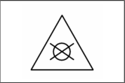|Carga d'água pressurizada (AP)|Junto ao símbolo, deverá ser informado o número de ordem do extintor de incêndio, o tipo de agente extintor e sua capacidade extintora.|
||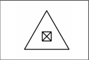|Carga de pó químico seco (PQS) BC||
||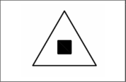|Carga de pó químico seco (PQS) ABC||
||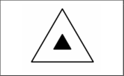|Carga de gás carbônico (CO2)||
||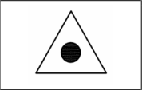|Carga de espuma mecânica (EM)||
||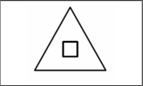|Carga de halogenado||
|Extintordeincêndiosobrerodas|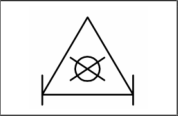|Carga d'água pressurizada (AP)|Junto ao símbolo, deverá ser informado o número de ordem do extintor de incêndio, o tipo de agente extintor e sua capacidade extintora.|
||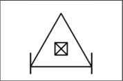|Carga de pó químico seco (PQS) BC||
||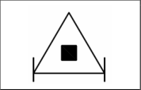|Carga de pó químico seco (PQS) ABC||
||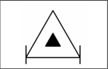|Carga de gás carbônico (CO2)||

<!-- pág 5 -->

ANEXO A

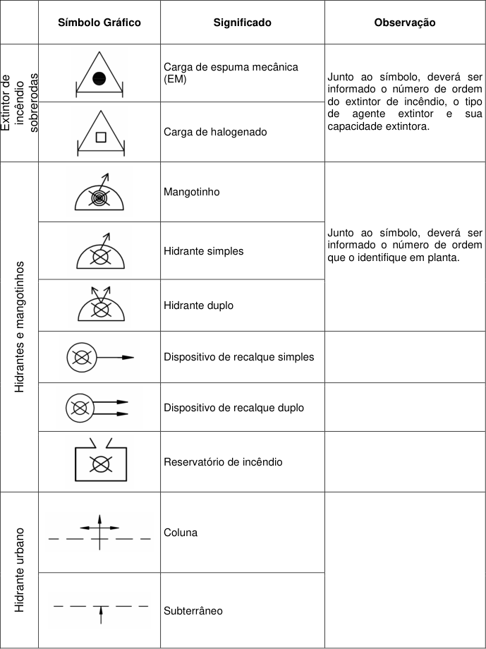
<!-- texto na figura: Símbolo Gráfico Significado Observação Carga de espuma mecânica (EM) Extintor de incêndio sobrerodas Carga de halogenado Junto ao símbolo, deverá ser informado o número de ordem do extintor de incêndio, o tipo de agente extintor e sua capacidade extintora. Mangotinho Hidrante simples Hidrante duplo Junto ao símbolo, deverá ser informado o número de ordem que o identifique em planta. Dispositivo de recalque simples Dispositivo de recalque duplo Hidrantes e mangotinhos Reservatório de incêndio Coluna Hidrante urbano Subterrâneo -->

<!-- pág 6 -->

ANEXO A

||Símbolo Gráfico|Significado|Observação|
|---|---|---|---|
|incêndio Alarmede|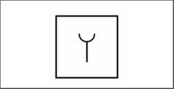|Acionador manual de alarme de incêndio|Junto ao símbolo, deverá ser informado o número de ordem que o identifique em planta.|
||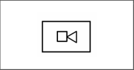|Central de detecção e alarme||
|Saídadeemergência|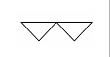|Barra antipânico||
||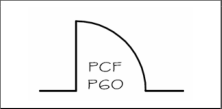|Porta corta-fogo|Junto ao símbolo, deverá ser informado o tempo de resistência o fogo da porta corta-fogo.|
||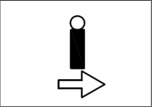|Iluminação de balizamento|Junto ao símbolo, deverá ser informado o número de ordem que o identifique em planta e o código do tipo de sinalização de acordo com a ABNT NBR 13434-2/2004.|
||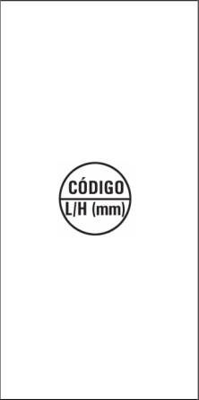|Sinalização de orientação e salvamento|Junto ao símbolo, deverá ser informado o número de ordem que o identifique em planta. Em planta baixa, os pontos onde serão implantadas as sinalizações deverão estar indicados por uma circunferência dividida horizontalmente em duas partes iguais, sendo que na parte superior deverá constar o código do símbolo e na parte inferior deverão constar suas dimensões, em milímetros. O código deverá ser consultado na ABNT NBR 13434-2/2004|
|Acessode viaturas|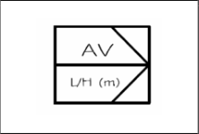|Pórtico do acesso de viaturas|Na parte inferior do símbolo, deverão constar as suas dimensões, em metros.|
|viaturas Acessode|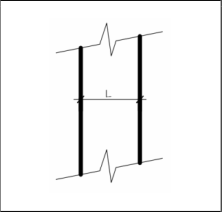|Vias de acesso interno|As dimensões dos acessos internos, quando obrigatórios, deverão ser cotadas com sua largura “L” em metros.|

<!-- pág 7 -->

ANEXO A

||Símbolo Gráfico|Significado|Observação|
|---|---|---|---|
|Redeseca|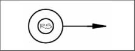|Dispositivo de recalque simples para rede seca||
||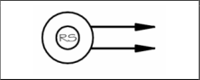|Dispositivo de recalque duplo para rede seca||
||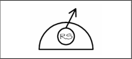|Hidrante simples para rede seca|Junto ao símbolo, deverá ser informado o número de ordem que o identifique em planta.|
||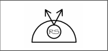|Hidrante duplo para rede seca||
||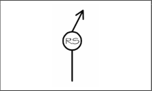|Hidrante de coluna simples para rede seca||
||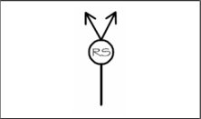|Hidrante de coluna duplo para rede seca||
|corta-fogo Elementos|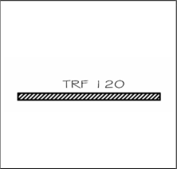|Elementos corta-fogo para isolamento de riscos e saídas de emergência.|Junto ao símbolo, deverá ser informado o tempo de resistência ao fogo do elemento corta-fogo.|
